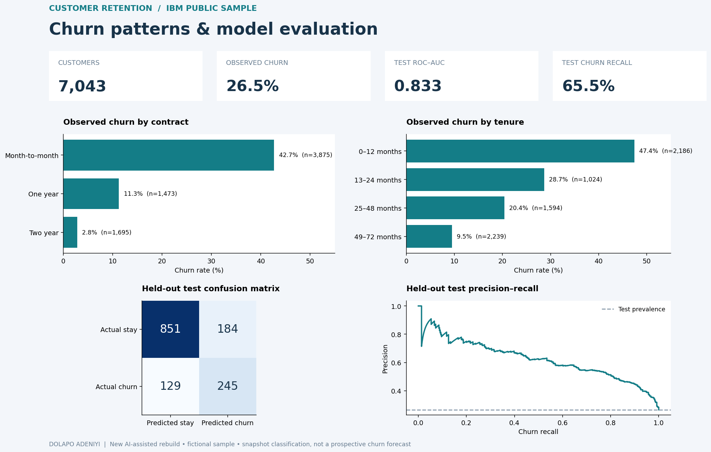

# Customer Churn Analysis & Classification | Dolapo Adeniyi

**Business question:** Which customer segments have the highest observed churn, and can a model distinguish churners better than a majority-class baseline?

A new AI-assisted portfolio rebuild, completed in October 2026 using IBM's public fictional Telco Customer Churn sample. Tools: **Python, Pandas, Scikit-learn, SQL and an interactive HTML dashboard**. This work demonstrates a reproducible analysis; it is not a client deployment.

## Review in two minutes

- **Explore:** Download and extract [CustomerChurn_Project.zip](CustomerChurn_Project.zip), then open `dashboard.html` in your browser. No installation, account or internet connection is needed for the dashboard. GitHub displays the HTML source rather than running it.
- **Inspect:** [Model and data pipeline](build_churn.py), [rerunnable notebook](churn_analysis.ipynb), [SQL cohorts](analysis.sql), [evaluation metrics](metrics.json), [test predictions](holdout_predictions.csv), and [split manifest](split_manifest.csv).
- **Reproduce:** With Python 3.12, run `python -m pip install -r requirements.txt`, then `python build_churn.py` and `python verify_outputs.py`. Optional dashboard logic check: `node verify_dashboard.cjs`.

## Data and preparation

One row represents one customer: **7,043 customers**, of whom **1,869 (26.5%)** have an observed churn label. `Churn` refers to customers who left within the last month. This is a single snapshot rather than a longitudinal prediction dataset.

`TotalCharges` contains 11 blank values. They are converted to missing numeric values; median imputation is fitted on training customers only. Customer IDs are checked for uniqueness and excluded from model features. The target and target-derived reporting fields are excluded. Demographic fields are excluded from this model. Categorical values are one-hot encoded, and numeric features are scaled inside the fitted pipeline.

## Model evaluation

A stratified, seed-42 split assigns **4,225 training / 1,409 validation / 1,409 test** customers. One logistic regression model is fitted on training only. The decision threshold, **0.41**, maximises validation F1 on a prespecified 0.15–0.70 grid. The test set is evaluated after that choice; it is not used for threshold selection or model fitting.

| Held-out metric | Majority-class baseline | Logistic regression |
| --- | ---: | ---: |
| Accuracy | 73.5% | 77.8% |
| Churn precision | 0.0% | 57.1% |
| Churn recall | 0.0% | 65.5% |
| Churn F1 | 0.000 | 0.610 |
| ROC–AUC | 0.500 | 0.833 |
| Average precision | 0.265 | 0.625 |

At the chosen threshold, the model identifies **245 of 374 churners**, misses 129, and flags 184 stayers. A conventional 0.50 threshold produces 78.9% accuracy but only 53.5% recall; the validation-selected threshold makes the precision/recall tradeoff explicit. Both results are retained in `metrics.json` rather than choosing whichever test figure looks best.

## Findings and business interpretation

- Month-to-month customers have **42.7% observed churn**, compared with 11.3% for one-year and 2.8% for two-year contracts.
- Customers in their first 12 months have **47.4% observed churn**, versus 9.5% among customers with 49–72 months of tenure.
- These patterns identify segments worth investigating for onboarding or retention research. They do not prove that changing a contract or providing an offer will prevent churn. A prospective trial would be needed to measure retention lift and financial return.

Dashboard cohort filters recompute counts and observed rates. Evaluation metrics remain tied to the fixed test set. There are no live customer risk scores or automated retention decisions.

## Verification and limitations

The pipeline and independent output checks have run successfully. Checks cover source checksum, unique customer IDs, disjoint split ownership, cohort reconciliation and independent recomputation of all six test metrics and the confusion matrix. The actual dashboard JavaScript passes a headless DOM harness for initial totals, contract filtering, empty cohorts, reset and fixed evaluation rows. The PNG was visually inspected; full browser rendering of the HTML has not been separately verified. The notebook is a rerunnable entry point with script-derived result documentation; it has not been separately executed in a notebook kernel.

This historical sample does not establish future-horizon performance, current Nigerian customer behaviour, production readiness or causal retention impact. The CV's earlier approximately 85% accuracy claim belongs to a separate historical project whose original evidence is unavailable here. **This rebuild measures 77.8% accuracy at its validation-selected threshold and does not substantiate that historical claim.** A suitable CV description for this rebuild is included in [CV_Project_Bullet.txt](CV_Project_Bullet.txt).

## Source and attribution

- Dataset: [IBM Telco Customer Churn CSV](https://github.com/IBM/telco-customer-churn-on-icp4d/blob/master/data/Telco-Customer-Churn.csv); upstream blob `3de7a612d1609f25f21a455bda77948729369002`.
- IBM's [sample description](https://www.ibm.com/docs/en/cognos-analytics/11.2.x?topic=samples-telco-customer-churn).
- Raw CSV SHA-256: `16320c9c1ec72448db59aa0a26a0b95401046bef5d02fd3aeb906448e3055e91`.
- The raw CSV is unchanged. Derived CSVs, scripts, notebook, plots and dashboard are new outputs and are not IBM-authored. The upstream Apache 2.0 licence is preserved in [LICENSE-IBM.txt](LICENSE-IBM.txt). No upstream NOTICE file was listed in the source repository root.

[Sales Performance Dashboard](../sales-performance-dashboard/README.md) · [Back to portfolio](../../README.md)
