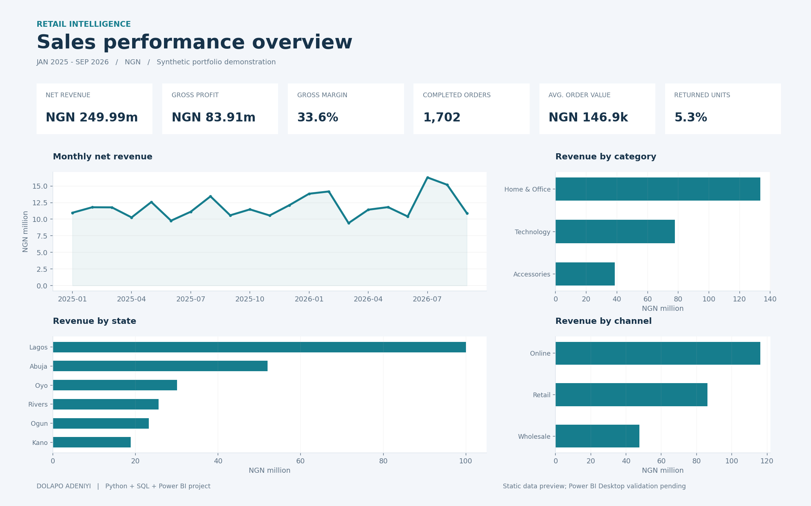

# Retail Sales Performance | Dolapo Adeniyi

A new, AI-assisted portfolio project created in October 2026 for a fictional Nigerian retailer. All records, prices and results are synthetic. This is not a client engagement or a reconstruction of an earlier project.



## Review the project

- Download and extract [RetailSales_Project.zip](RetailSales_Project.zip), then open `powerbi/RetailSales.pbip` in a current Windows Power BI Desktop with Power BI project/enhanced report support enabled. Refresh to load the embedded synthetic CSV. There are no credentials or local data paths to configure.
- The report definition contains six KPI cards and four charts for monthly revenue, category, state and channel. Click chart categories to explore cross-filtering.
- Review [Python generation and cleaning](build_sales.py), [SQL analysis](analysis.sql), [DAX measures](measures.dax), [clean sales](sales_clean.csv) and [quality report](quality_report.json).
- `dashboard_preview.png` is rendered with Matplotlib from the same data. It is a separate static preview, not a screenshot from Power BI Desktop.

## Business questions

1. How do sales and gross margin develop over time?
2. Which categories, locations and channels contribute most revenue?
3. How much do returns reduce revenue, and what is average completed-order value?

## Metric definitions

Revenue = ordered units x price - discount - refunded returned units. Cancelled orders contribute zero revenue and cost. Gross profit subtracts the cost of units retained by customers; gross margin divides total gross profit by total net revenue. Completed orders use distinct completed order IDs, even when an order has multiple lines. Returned-unit rate uses returned units / ordered units from completed orders. Currency is NGN. Taxes, delivery expenses, overhead and return-processing costs are excluded, so gross profit is not net profit. Returns are attributed to the original sale month; this is not a cashflow model.

## Data quality and model

The deterministic generator (seed 42) produces 1,800 orders across January 2025 through September 2026. One row represents one order line. The cleaning step standardizes labels, removes exact repeated line identifiers and quarantines invalid quantities. The quality report reconciles raw rows to removed, rejected and retained rows.

The intentionally compact model has one typed Sales fact table, with descriptive category, state, channel and month columns. This version does not implement a date dimension, YTD/YoY calculations or a star schema. Dates in YYYY-MM form sort chronologically for the monthly chart. The small dataset is embedded in Power Query for portability; use a managed source for a production model.

## Reproduce

Python 3.9+ standard library:

```bash
python3 build_sales.py
```

The script regenerates the raw/clean data, row-quality report, SQL/DAX files and native Power BI project. It asserts line-key uniqueness, row reconciliation, revenue arithmetic and independent SQLite/Python total agreement. `preview.py` additionally requires Matplotlib and produces the static preview.

## Findings and interpretation

The simulated dataset produces NGN 249,993,525 net revenue, NGN 83,906,025 gross profit and 33.56% gross margin, across 1,702 completed orders. Average order value is NGN 146,882; returned-unit rate is 5.34%. Use the category/channel charts to identify where to investigate margin and returns. Patterns reflect generator assumptions, not evidence about Nigerian consumers; no causal or real-world performance claim is made.

## Validation status

Python/SQLite reconciliations and JSON structure/data-binding checks pass. Full Microsoft JSON-schema validation has not been run because a schema validator is unavailable here. The Power BI project has **not been opened or refreshed in Power BI Desktop in this environment**. Rendering, DAX execution and Power Query import still require a Desktop check. This is editable project source, not a tested .pbix file. Import `theme.json` in Desktop if you want the teal/navy palette used by the preview.

Official format references: [Power BI projects](https://learn.microsoft.com/en-us/power-bi/developer/projects/projects-overview), [report format](https://learn.microsoft.com/en-us/power-bi/developer/projects/projects-report), [semantic model format](https://learn.microsoft.com/en-us/power-bi/developer/projects/projects-dataset).
